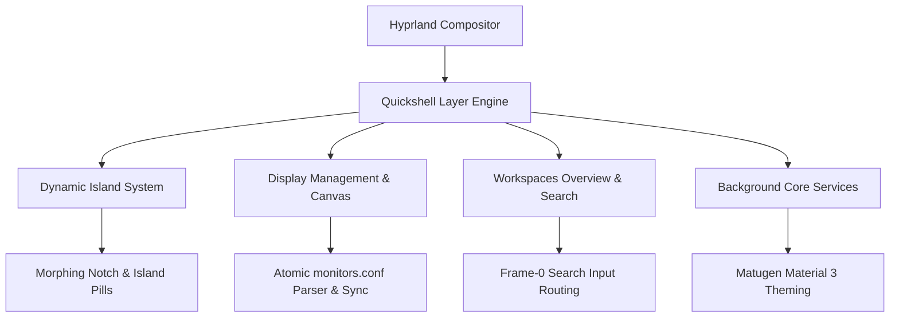

<div align="center">

# ii-DYNAMiC

**A Material 3 Expressive desktop environment for Hyprland, powered by Quickshell.**

[](https://hypr.land/)
[](https://quickshell.org/)
[](https://github.com/InioX/matugen)
[](LICENSE)

</div>

<br>

**ii-DYNAMiC** is a modern, modular, and highly expressive desktop shell for Linux. Derived from **[ii-p3drovfx](https://github.com/P3DROVFX/ii-p3drovfx)**, **[ii-vynx](https://github.com/vaguesyntax/ii-vynx)**, and the foundational **[illogical-impulse](https://github.com/end-4/dots-hyprland)** architecture, it brings **Material 3 Expressive** design to Hyprland: fluid state-morphing surfaces, optical geometry alignment, dynamic palette generation via Matugen, and seamless multi-monitor management.

---

## Architecture Overview

### System Stack (ASCII Architecture Diagram)
```
 +-----------------------------------------------------------------------------------+
 |                              Wayland Compositor                                   |
 |                        Hyprland (monitors.conf, keybinds)                         |
 +-----------------------------------------+-----------------------------------------+
                                           |
                                           v
 +-----------------------------------------------------------------------------------+
 |                         Quickshell Reactive Runtime Engine                        |
 |                (GlobalStates, PanelWindows, Wayland Layer Surfaces)               |
 +--------------------+---------------------------------------+----------------------+
                      |                                       |
                      v                                       v
 +---------------------------------------+ +-----------------------------------------+
 |             Visual Shell              | |             Core Services               |
 |  - Dynamic Island (Notch & Pills)     | |  - ShellUpdates (GitHub Branch Probing) |
 |  - Top Bar & Autohide Bus             | |  - MonitorManager (Atomic Sync & Conf)  |
 |  - Workspaces Overview & App Drawer   | |  - Media, Battery, Audio & OSD Services |
 |  - Settings App & Displays Canvas     | |  - TypeToSearch & Launcher Engine       |
 +--------------------+------------------+ +--------------------+--------------------+
                      |                                       |
                      +-------------------+-------------------+
                                          |
                                          v
 +-----------------------------------------------------------------------------------+
 |                              Dynamic Material Theme                               |
 |                      Matugen (M3 Color Palette & Gradients)                       |
 +-----------------------------------------------------------------------------------+
```

### Visual Architecture Flowchart


---

## Key Features & Highlights

### 1. Dynamic Island
- **Zero-Lag Type-to-Search**: Instant search input buffering on frame 0. Typing immediately after clicking Super seamlessly transitions into Search without dropping the first character during the opening animation.
- **Instant Collapse**: Pressing **`Esc`** while expanded collapses the island directly to its compact, resting time-only clock face.
- **Flexible Multi-Monitor Scoping**: Choose between all-display mirrored status ambience or pinning the island exclusively to your primary display (`bar.floatingNotch.onlyShowOnSingleMonitor`).
- **Contextual Ambient Overlays**: Real-time cards for media playback, volume, brightness, battery charging, notifications, timer countdowns, and system activities.
- **Failsafe Hyprland Grab Arbitration**: Smart window focus grabbing that prevents instant dismiss races and flicker when typing or clicking popups.

### 2. Multi-Monitor Display Management
- **Visual Arrangement Canvas (Settings -> Displays)**: Interactive drag-and-drop monitor positioner with zoom toolbar controls and live coordinate rendering.
- **Dedicated Primary Monitor Selector**: Explicit primary toggle with live `★ Primary` canvas badges and guaranteed single-primary deduplication in both `monitors.json` and `monitors.conf`.
- **Atomic Layout Reloading**: Applies display updates seamlessly without intermediate `0x0` overlaps, completely eliminating compositor yellow warning banners.
- **Unified Configuration Parser**: Single source of truth across Hyprland configuration, the `hyprmon` CLI, and Quickshell's Displays settings.

### 3. Hardware Keybinds & Safety
- **Dedicated Copilot Key Support**: Native hardware key mapping for Copilot keys (`Super+Shift+F23`, `code:201`, `XF86Assistant`) to toggle Workspaces Overview cleanly.
- **Super Tap Release Binds**: Single-tap Super toggles the Dynamic Island widgets dashboard with smooth typeahead handoff.
- **Hardware Switch Protection**: Volume mute, mic mute, and touchpad toggles execute with `ignore_mods = true` so laptop hardware switches always register reliably.

### 4. Rebuilt Top Shell Autohide Engine
- **Centralized Hover Bus**: Centralized top-edge detection in `GlobalStates.qml` eliminates pointer oscillation and bar jitter.
- **Window Overlay Mode**: When `pushWindows: false` is enabled, the top bar and island slide smoothly above open windows without resizing tiled layouts or triggering desktop reflow.

### 5. Built-in Apps & Tools
- **Settings App (`Super + I`)**: Unified control center for appearance, wallpapers, top bar, dynamic island, displays, audio, and shortcuts.
- **Workspaces Overview (`Super + Tab` / `Copilot Key`)**: Fluid overview of active workspaces with live window previews, window search, and application drawer modes.
- **Cheatsheet (`Super + /`)**: Keybinds reference, integrated calendar (Google, Outlook, ICS), typing test, and offline dev tools.
- **Companion Bridge (`ii-tools`)**: Device pairing over LAN/Tailscale for clipboard sharing, touchpad control, and screen mirroring.
- **Sports Tracker**: Live Cricket cards with interactive batting/bowling scorecards, ATP Tennis rankings and scores, and an F1 timing tower with OpenF1 session results and weekend schedules.
- **Modes & Routines (`Super + Y`)**: Profile automation for work, gaming, presentation, and bedtime modes.

---

## Default Keybindings

| Shortcut | Action | Description |
| :--- | :--- | :--- |
| **`Super`** (Tap) | Dynamic Island Dashboard | Toggle widget dashboard and type-to-search |
| **`Copilot Key`** / **`Super + Tab`** | Workspaces Overview | Open workspace overview and window thumbnails |
| **`Super + V`** | Clipboard History | Open clipboard manager and search |
| **`Super + I`** | Settings App | Open comprehensive system and shell settings |
| **`Super + /`** | Cheatsheet | Open keyboard shortcuts and utility cheatsheet |
| **`Super + A`** | Left Sidebar | Toggle left notifications and widgets sidebar |
| **`Super + N`** | Right Sidebar | Toggle right quick-settings sidebar |
| **`Super + Return`** | Terminal | Open default terminal (Kitty) |
| **`Super + E`** | File Manager | Open default file manager (Dolphin) |
| **`Super + W`** | Web Browser | Open default browser |
| **`Ctrl + Super + R`** | Restart Shell | Cleanly restart Quickshell widgets and guard |

---

## Requirements

- **Linux Distribution**: Arch Linux, CachyOS, Fedora, or NixOS
- **Compositor**: Hyprland `0.56.1` or newer
- **Toolkit**: `quickshell-git` `0.3.0` or newer (or `aur/quickshell-ii-git`)
- **Dynamic Theming**: `matugen` `4.1.0` or newer

---

## Installation

### Standard Installation (Full Desktop Environment)

Clone the repository with submodules and run the setup installer:

```bash
git clone --recurse-submodules https://github.com/imyash0722/ii-DYNAMiC.git
cd ii-DYNAMiC
./setup-ii-p3drovfx.sh install
```

### Minimal Installation (Quickshell Configuration Only)

If you already manage your own Hyprland dotfiles and only want the Quickshell configuration:

```bash
git clone --recurse-submodules https://github.com/imyash0722/ii-DYNAMiC.git
cd ii-DYNAMiC
./setup-ii-p3drovfx.sh
```

---

## Updating

Update seamlessly from the Settings app (**Settings -> About**) or via the command line:

```bash
./setup-ii-p3drovfx.sh update
```

The shell's built-in update probe will notify you via the Dynamic Island whenever new commits are pushed to `origin/dev`.

---

<details>
<summary><strong>🛠 Troubleshooting & Frequently Asked Questions</strong></summary>

<br>

### 1. Dynamic Colors / Matugen Not Applying
Verify that both Matugen and Quickshell are in your PATH:
```bash
matugen --version
quickshell --version
```
On Arch Linux / CachyOS, ensure you are running `aur/quickshell-git`:
```bash
yay -S aur/quickshell-git
```

### 2. Quickshell Stops Working After a Qt Update
If Qt packages were updated on your system, rebuild Quickshell against the new Qt libraries:
```bash
yay -S --rebuild aur/quickshell-git
```

### 3. Restarting the Quickshell Process Manually
To cleanly reload all widgets and the crash guard:
```bash
killall ydotool 2>/dev/null; qs kill -c ii || killall qs quickshell 2>/dev/null; ~/.config/quickshell/ii/scripts/quickshell-guard/qs-guard.sh -c ii &
```
*(Or simply press `Ctrl + Super + R`)*

### 4. Monitor Overlap Banners
If you see yellow overlap warnings in Hyprland, open **Settings -> Displays (`Super + I`)**, select your primary display, adjust your monitor positions on the canvas, and click **Save**.

</details>

---

## Credits & Acknowledgements

Special credit and gratitude to **[P3DROVFX](https://github.com/P3DROVFX/ii-p3drovfx)** for the original project and its foundational architecture.

- **[P3DROVFX](https://github.com/P3DROVFX/ii-p3drovfx)** — Creator of the original ii-p3drovfx shell
- **[end-4](https://github.com/end-4)** — Creator of illogical-impulse dotfiles
- **[vaguesyntax](https://github.com/vaguesyntax)** — Creator of ii-vynx
- **[pc-trade](https://github.com/pctrade)** — Design and feature inspirations
- **[so-do-i-look-like-him](https://github.com/so-do-i-look-like-him)** — Installation improvements
- **[asteriau](https://github.com/asteriau)** — Cheatsheet keybind animations
- **[hnpf](https://github.com/hnpf)** — Nothing widgets design
- **[gowall](https://github.com/Achno/gowall)** — Dynamic icon theming
- **[hyprmon](https://github.com/erans/hyprmon)** — Monitor management CLI
- **[Quickshell](https://quickshell.org/)** — Reactive desktop shell toolkit
- **[Hyprland](https://hypr.land/)** — Wayland compositor

<br>

<div align="center">
  <b>⭐ If you enjoy using ii-DYNAMiC, consider starring the repository!</b>
</div>
